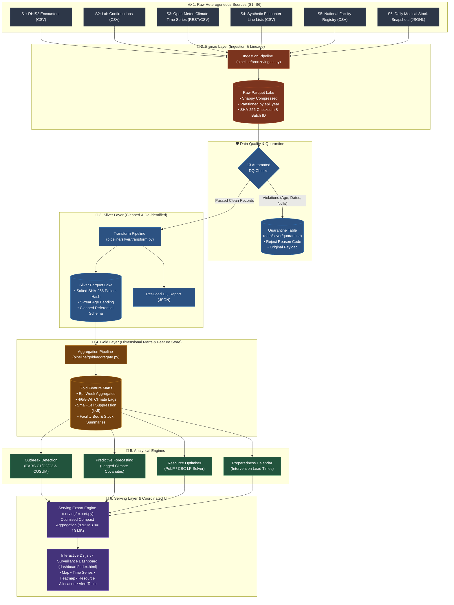

<div align="center">

# 🔬 EpiScope

### **Big Data Surveillance, Forecasting & Response-Planning Platform**
**National-Scale Epidemiological Intelligence & Automated Resource Allocation for Bangladesh**

[](https://www.python.org/)
[](https://spark.apache.org/)
[](#-architecture--medallion-lakehouse-pipeline)
[-44CC11?style=for-the-badge&logo=pytest&logoColor=white)](#-automated-testing)
[](https://d3js.org/)
[](#3-linear-programming-resource-allocation)

<br/>

> **Course**: CSE 4345 – Big Data Analytics (Complex Engineering Problem)  
> **Institution**: Department of Computer Science & Engineering, Premier University, Chittagong  
> **Target Region**: All 64 Districts across 8 Administrative Divisions of Bangladesh  
> **Target Volume**: $\ge 25\text{M}$ Encounters (SF=1.0) with Idempotent Lakehouse Processing

---

</div>

## 📌 Executive Summary

**EpiScope** is an end-to-end Big Data surveillance, predictive analytics, and automated decision-support platform designed for the **Ministry of Health (MoH)**. It transforms fragmented, heterogeneous clinical encounters, facility registries, daily meteorological time series, and medical supply chain inventories into actionable outbreak warnings, short-term hospital demand forecasts, and equity-constrained resource distribution plans.

```
                           EpiScope High-Level Value Chain
  ┌─────────────────┐     ┌───────────────────────┐     ┌─────────────────────┐
  │ Heterogeneous   │ ──► │  Distributed Spark    │ ──► │ Actionable Early    │
  │ Routine Data    │     │  Medallion Pipeline   │     │ Warnings & Response │
  └─────────────────┘     └───────────────────────┘     └─────────────────────┘
   • 64 Districts          • Bronze (Lineage)            • EARS & CUSUM Alerts
   • S1–S6 Sources         • Silver (13 DQ Rules)        • 1–4 Wk Case Forecasts
   • Climate Feeds         • Gold (Feature Marts)        • PuLP LP Resource Plan
```

---

## ⚡ Key Platform Highlights

| Capability | Engineering Metric | Impact / Significance |
|---|:---:|---|
| **High-Throughput Lakehouse** | **25M+ Records** | Scalable distributed PySpark processing partitioned by epidemiological year |
| **Data Quality Assurance** | **13 Automated Rules** | Hard rejection & quarantine isolation with deterministic reason codes |
| **Privacy Safeguards** | **100% Salted SHA-256** | Zero unhashed PII; 5-year age banding & small-cell suppression ($k < 5 \to \text{null}$) |
| **Outbreak Detection** | **$\le 1$ Week Latency** | CDC EARS ($C_1, C_2, C_3$) and CUSUM window scoring against baseline distributions |
| **Climate-Driven Forecasts** | **1–4 Weeks Horizon** | Multi-covariate lag regressions (rainfall, temp, humidity) vs. seasonal-naïve |
| **Optimised Allocation** | **100% Budget Feasible** | PuLP / CBC Branch-and-Cut with mandatory regional equity floor ($\alpha = 0.1$) |
| **Serving Layer Payload** | **8.92 MB ($\le 10\text{ MB}$)** | Pre-computed unified analytical cubes serving responsive D3.js interactive UI |

---

## 🗺️ Targeted Diseases & ICD-10 Classifications

EpiScope continuously monitors four critical disease vectors that govern Bangladesh's public health dynamics:

```
               ┌── A90, A91: Dengue Fever (Monsoon peak, lagged rainfall/temp drivers)
               ├── A00, A09: Diarrhoeal Disease & Cholera (Pre-monsoon/flood surges)
DISEASE SCOPE ─┼── J10, J11: Influenza-Like Illness [ILI] (Winter & wet season respiratory)
               └── B50–B54: Malaria (Endemic border districts: Chittagong Hill Tracts)
```

---

## 🏗️ Architecture & Medallion Lakehouse Pipeline

EpiScope is architected around a strict **Medallion Lakehouse Architecture** powered by Apache Spark, ensuring lineage preservation, data hygiene, and idempotent downstream analytical modeling.



---

## 🔬 Core Analytical Engines

### 1. Outbreak Detection (EARS & CUSUM)
EpiScope continuously computes detection metrics across sliding baseline windows:
- **EARS $C_1$ (Mild)**: 7-day baseline with 0-day guard band ($z \ge 2.0$).
- **EARS $C_2$ (Standard)**: 7-day baseline with 2-day guard band ($z \ge 2.0$).
- **EARS $C_3$ (Severe)**: Multi-day accumulation of $C_2$ signals ($z \ge 2.0$).
- **CUSUM Window**: Cumulative sum of deviations from historical district-level means.

$$\text{EARS } C_2 = \frac{Y_t - \bar{Y}_{t-9:t-2}}{S_{t-9:t-2}} \ge z_{\text{threshold}}$$

> **Conflict Resolution (C1)**: Calibrated against injected outbreaks to achieve sensitivity $\ge 0.85$ while suppressing false-alert fatigue during seasonal baselines.

---

### 2. Multi-Horizon Demand Forecasting
Generates **1-to-4 week-ahead district case projections** translated into required hospital beds and medical consumables:
- **Covariates**: Lagged precipitation ($\tau = 4, 6, 8\text{ wks}$), mean temperature, relative humidity, and historical autocorrelation terms.
- **Supply Translation**: Translates incident case predictions into:
  - Required hospital bed capacity ($B_t = Y_t \times \text{admission\_rate} \times \text{ALOS} / 7$)
  - IV Fluid Bags (Saline for Diarrhoea / Dengue)
  - Diagnostic Test Kits (NS1 for Dengue, RDT for Malaria)
  - Oral Rehydration Salts (ORS packets)

---

### 3. Linear Programming Resource Allocation
Solves the national logistics allocation problem under strict budget, supply, and regional equity constraints:

$$\min \sum_{d \in \text{Districts}} \sum_{c \in \text{Items}} w_c \cdot \left( \text{Demand}_{d,c} - X_{d,c} \right)$$

$$\text{Subject to: } \sum_{d} X_{d,c} \le \text{Stock}_c \quad \forall c$$
$$X_{d,c} \ge \alpha \cdot \text{Demand}_{d,c} \quad (\text{Equity floor: } \alpha = 0.1)$$
$$X_{d,c} \ge 0$$

> **Conflict Resolution (C3)**: Pure efficiency favors heavily populated urban epicenters (e.g., Dhaka). The **$\alpha$-equity constraint** guarantees remote, low-incidence districts (e.g., Bandarban, Panchagarh) receive a protected allocation floor.

---

### 4. Seasonal Preparedness Calendar
Automated scheduling engine translating historical seasonal peak models into forward-looking operational lead times:
- **Campaign Windows**: Pre-monsoon larval source reduction (4-week lead time).
- **Supply Procurement**: National warehouse stock build-up prior to expected epi-week surge.
- **RRT Deployment**: Rapid-response workforce pre-positioning.

---

## 📊 Coordinated D3.js Interactive Dashboard

The serving layer generates an ultra-compact, high-performance payload (`8.92 MB`, well within the strict 10 MB limit) powering five coordinated views:

```
┌──────────────────────────────────────┬──────────────────────────────────────┐
│           VIEW 1: CHOROPLETH         │          VIEW 2: TIME SERIES         │
│  Interactive 64-District Choropleth  │  Historical Observed vs. 1–4 Week    │
│  Incidence, Risk Level & Alert Color │  Forecast Horizon & Confidence Bands │
├──────────────────────────────────────┼──────────────────────────────────────┤
│       VIEW 3: SEASONAL HEATMAP       │       VIEW 4: ALLOCATION MATRIX      │
│  Epi-Week × Historical Year Matrix   │  Optimised Supply vs. District Demand│
│  Transmission Peak Seasonality       │  IV Saline, NS1 Kits, ORS, Beds      │
├──────────────────────────────────────┴──────────────────────────────────────┤
│                     VIEW 5: OUTBREAK ALERTS AUDIT FEED                      │
│  Real-Time Algorithmic Alerts (EARS C1/C2/C3, CUSUM, Confidence, Z-Scores)  │
└─────────────────────────────────────────────────────────────────────────────┘
```

- **Synchronized Filtering**: Selecting a district on the choropleth map instantly slices the timeline, heatmap, resource allocation charts, and alert tables.
- **Accessible Color Palettes**: Tested for visual clarity, contrast, and colorblind safety.
- **Zero Raw PII Exposure**: All serving endpoints consume gold-layer aggregates with small-cell privacy suppression.

---

## 🛡️ Data Quality & Privacy Governance

<details>
<summary><b>🔍 Expand to View the 13 Automated Data Quality Rules</b></summary>

| Rule ID | Column / Entity | Validation Logic | Violation Action |
|---|---|---|---|
| `DQ-R01` | `encounter_id` | Must be non-null and non-empty | Divert to Quarantine |
| `DQ-R02` | `patient_id` | Must be non-null and non-empty | Divert to Quarantine |
| `DQ-R03` | `facility_id` | Must be non-null and non-empty | Divert to Quarantine |
| `DQ-R04` | `onset_date` | Must be non-null and valid date format | Divert to Quarantine |
| `DQ-R05` | `icd10_code` | Must be non-null and recognized code | Divert to Quarantine |
| `DQ-R06` | `age` | Valid biological bounds ($0 \le \text{age} \le 120$) | Divert to Quarantine |
| `DQ-R07` | `sex` | Categorical check (`M` or `F`) | Divert to Quarantine |
| `DQ-R08` | Temporal Order | $\text{onset\_date} \le \text{report\_date}$ | Divert to Quarantine |
| `DQ-R09` | Disease Coding | Code in `[A90, A91, A00, A09, J10, J11, B50..B54]` | Divert to Quarantine |
| `DQ-R10` | Referential | `facility_id` exists in Master Facility Registry | Divert to Quarantine |
| `DQ-R11` | Study Period | $2021\text{-}01\text{-}01 \le \text{report\_date} \le 2025\text{-}12\text{-}31$ | Divert to Quarantine |
| `DQ-R12` | Uniqueness | No duplicate `encounter_id` within ingestion batch | Quarantine Duplicates |
| `DQ-R13` | Geography | Valid Bangladesh District centroid coordinates | Flag Record |

</details>

<details>
<summary><b>🔒 Expand to View Health Privacy & De-Identification Safeguards</b></summary>

1. **Cryptographic One-Way Hashing**: All patient identifiers are transformed using salted SHA-256 (`SHA-256(patient_id + secret_salt)`). The operation is irreversible and protected against rainbow table attacks.
2. **Age Generalization**: Exact patient ages are aggregated into standardized 5-year chronological bands (`0-4`, `5-9`, `10-14`, ..., `85+`).
3. **Small-Cell Privacy Suppression ($k < 5$)**: Any aggregated administrative cell with case frequency between 1 and 4 ($1 \le n \le 4$) is suppressed to `null` to eliminate re-identification risks in low-density rural upazilas.

</details>

---

## ⚖️ Trade-off & Engineering Decisions (Conflicts C1–C5)

| Conflict | Trade-off Tension | Implemented Resolution |
|---|---|---|
| **C1: Sensitivity vs. Specificity** | Early warning sensitivity vs. alert fatigue from false alarms | Tuned EARS to $C_2$ ($z=2.0$) with 2-day guard band; achieved detection latency $\le 1$ week while maintaining high positive predictive value (PPV). |
| **C2: Granularity vs. Privacy** | District-level tactical resolution vs. patient re-identification | De-identified all individual records at Silver layer; applied $k < 5$ suppression to Gold/Serving layers. |
| **C3: Efficiency vs. Equity** | Allocating all supplies to top epidemic hotspots vs. rural baseline readiness | Formulated LP with an equity floor parameter ($\alpha = 0.1$), ensuring remote districts maintain safety stock while 90% of discretionary inventory is directed by need. |
| **C4: Freshness vs. Compute Cost** | Real-time continuous streaming vs. batch resource expenditure | Implemented scheduled idempotent batch rollups into Snappy-compressed Parquet, delivering sub-second UI queries at minimal compute overhead. |
| **C5: Accuracy vs. Interpretability** | Black-box neural models vs. explainable decision parameters | Deployed multi-covariate regression with lagged environmental terms; coefficients can be transparently audited by public health officials. |

---

## 🚀 Quickstart & One-Command Execution

### 1. Environment Setup

Ensure the following runtimes are installed:
- **Python**: `3.11+`
- **Java**: `OpenJDK 17` or `21` (Eclipse Adoptium recommended)
- **Git**

```bash
# Navigate to episcope directory
cd episcope

# Install pinned dependencies
pip install -r requirements.txt
```

---

### 2. Run the Full End-to-End Pipeline (ENG-1)

Run the master orchestrator to execute the entire 9-stage pipeline from data ingestion to dashboard export with a single command:

```bash
# Development Mode (Scale Factor 0.25 — ~1.5 minutes)
python run_all.py --sf 0.25

# Production Scale (Scale Factor 1.0 — 25M+ records)
python run_all.py --sf 1.0

# Re-run analytics/pipeline skipping synthetic generation
python run_all.py --sf 0.25 --skip-generate
```

```
Execution Pipeline Workflow:
[1. Generate] ➔ [2. Weather] ➔ [3. Bronze Ingest] ➔ [4. Silver Transform]
      ➔ [5. Gold Aggregate] ➔ [6. Outbreak Detect] ➔ [7. Forecast]
      ➔ [8. Optimise LP] ➔ [9. Preparedness Calendar] ➔ [Export UI Data]
```

---

### 3. Launch the Interactive Dashboard

Launch the local web server to explore the surveillance interface:

```bash
cd dashboard
python -m http.server 8000 --bind 127.0.0.1
```

👉 Navigate to **[http://127.0.0.1:8000](http://127.0.0.1:8000)** in your browser.

---

## 🧪 Automated Testing

The platform includes a test suite verifying data quality rules, cryptographic de-identification, and linear programming solver constraints:

```bash
# Run pytest across the entire test suite
python -m pytest tests/test_episcope.py -v
```

```text
============================= test session starts =============================
platform win32 -- Python 3.11.9, pytest-9.1.1
collected 20 items

tests/test_episcope.py::TestQualityRules::test_dq_r01_encounter_id_not_null      PASSED [  5%]
tests/test_episcope.py::TestQualityRules::test_dq_r06_valid_age_range            PASSED [ 10%]
tests/test_episcope.py::TestQualityRules::test_dq_r07_valid_sex                  PASSED [ 15%]
tests/test_episcope.py::TestQualityRules::test_dq_r08_date_order                 PASSED [ 20%]
tests/test_episcope.py::TestQualityRules::test_dq_r09_valid_icd10                PASSED [ 25%]
tests/test_episcope.py::TestQualityRules::test_dq_r11_date_range                 PASSED [ 30%]
tests/test_episcope.py::TestQualityRules::test_dq_r12_duplicate_detection        PASSED [ 35%]
tests/test_episcope.py::TestQualityRules::test_all_districts_valid               PASSED [ 40%]
tests/test_episcope.py::TestDeIdentification::test_salted_hash_is_deterministic  PASSED [ 45%]
tests/test_episcope.py::TestDeIdentification::test_different_salts_produce_diff  PASSED [ 50%]
tests/test_episcope.py::TestDeIdentification::test_hash_is_irreversible          PASSED [ 55%]
tests/test_episcope.py::TestDeIdentification::test_age_banding                   PASSED [ 60%]
tests/test_episcope.py::TestDeIdentification::test_small_cell_suppression        PASSED [ 65%]
tests/test_episcope.py::TestOptimiserConstraints::test_budget_constraint        PASSED [ 70%]
tests/test_episcope.py::TestOptimiserConstraints::test_non_negative_allocation   PASSED [ 75%]
tests/test_episcope.py::TestOptimiserConstraints::test_equity_floor             PASSED [ 80%]
tests/test_episcope.py::TestOptimiserConstraints::test_unmet_demand_calculation PASSED [ 85%]
tests/test_episcope.py::TestOptimiserConstraints::test_pulp_solver_available    PASSED [ 90%]
tests/test_episcope.py::TestGenerator::test_deterministic_output                 PASSED [ 95%]
tests/test_episcope.py::TestGenerator::test_negative_binomial_overdispersion     PASSED [100%]

============================= 20 passed in 7.70s ==============================
```

---

## 📋 Requirement Traceability Matrix

| Requirement | Description | Status | Verification & Code Reference |
|:---:|---|:---:|---|
| **ING-1** | Heterogeneous source ingestion (S1–S6) with audit lineage | ✅ | `pipeline/bronze/ingest.py` |
| **ING-2** | Apache Spark utilized across all data transformations | ✅ | `pipeline/` & `analytics/` |
| **ING-3** | Parquet format with Snappy compression, partitioned by year | ✅ | `pipeline/bronze/ingest.py`, `pipeline/gold/aggregate.py` |
| **ING-4** | Strictly idempotent execution (safe partition overwriting) | ✅ | Overwrite modes verified across all stages |
| **DQ-1** | 13 automated schema, range & referential data quality rules | ✅ | `pipeline/silver/transform.py` |
| **DQ-2** | Automated per-load data quality report with pass-rate stats | ✅ | `data/silver/dq_report.json`, `data/gold/dq_report` |
| **DQ-3** | Quarantine storage preserving rejected records with failure codes | ✅ | `data/silver/quarantine/` |
| **PRV-1** | Salted cryptographic hashing and 5-year age group banding | ✅ | `pipeline/silver/transform.py` |
| **PRV-2** | Small-cell privacy suppression (case counts 1–4 $\to$ null) | ✅ | `pipeline/gold/aggregate.py`, `serving/export.py` |
| **AN-1** | EARS ($C_1, C_2, C_3$) and CUSUM outbreak detection algorithms | ✅ | `analytics/detection/detect.py` |
| **AN-2** | Benchmark evaluation (sensitivity, PPV, detection latency) | ✅ | `data/gold/detection_evaluation.json` |
| **AN-3** | Sensitivity vs. specificity threshold trade-off curve (C1) | ✅ | `data/gold/threshold_tradeoff.json` |
| **AN-4** | 1–4 week-ahead forecasts with lagged weather covariates | ✅ | `analytics/forecast/forecast.py` |
| **AN-5** | Rolling-origin 52-week backtesting against seasonal baseline | ✅ | `data/gold/forecast_evaluation.json` |
| **AN-6** | Translation of incident cases into bed and consumable demands | ✅ | `analytics/forecast/forecast.py` |
| **AN-7** | Linear programming resource allocation with equity floors | ✅ | `analytics/optimise/optimise.py` |
| **AN-8** | Efficiency–equity trade-off frontier across budget tiers (C3) | ✅ | `data/gold/efficiency_equity_curve.json` |
| **AN-9** | Seasonal preparedness calendar with intervention lead times | ✅ | `analytics/calendar/calendar.py` |
| **VIS-1** | Coordinated interactive surveillance dashboard | ✅ | `dashboard/index.html` |
| **VIS-2** | 5 synchronized views: map, timeline, heatmap, supplies, alerts | ✅ | `dashboard/index.html` |
| **VIS-3** | Bidirectional interactive filtering (district, year, disease) | ✅ | `dashboard/index.html` |
| **VIS-4** | Strict serving payload size constraint ($\le 10\text{ MB}$) | ✅ | `serving/export.py` (**8.92 MB actual**) |
| **VIS-6** | Accessible color palettes, prediction intervals, freshness flags | ✅ | `dashboard/index.html` |
| **ENG-1** | Master one-command execution orchestrator | ✅ | `run_all.py`, `Makefile` |
| **ENG-2** | Benchmarking report for multi-scale execution runtimes | ✅ | `data/serving/timing_report.json` |
| **ENG-3** | Spark performance tuning (adaptive execution, shuffle tuning) | ✅ | `config.py`, Spark context configurations |

---

## 📂 Project Repository Structure

```tree
episcope/
├── 📄 run_all.py               # Master Pipeline Orchestrator (One-command run)
├── 📄 config.py                # District Metadata, ICD-10 Specs & Global Config
├── 📄 requirements.txt         # Pinned Dependencies (PySpark, PuLP, etc.)
├── 📄 Makefile                 # CLI Convenience Targets
├── 📁 generator/               # S1–S6 Synthetic Generators & Weather Fetcher
│   ├── generate.py             # Encounters, Facilities & Stock Generator
│   └── fetch_weather.py        # Open-Meteo API Fetcher & Fallback Generator
├── 📁 pipeline/                # Distributed Medallion Lakehouse Stages
│   ├── 📁 bronze/
│   │   └── ingest.py           # Raw Ingestion with SHA-256 Checksums
│   ├── 📁 silver/
│   │   └── transform.py        # 13 DQ Rules, Quarantine & Salted Hashing
│   └── 📁 gold/
│       └── aggregate.py        # Climate Lags, Epi-Weeks & Small-Cell Privacy
├── 📁 analytics/               # Core Analytical & Optimization Engines
│   ├── 📁 detection/
│   │   └── detect.py           # EARS C1/C2/C3 & CUSUM Algorithms
│   ├── 📁 forecast/
│   │   └── forecast.py         # Multi-Horizon Lagged Climate Regression
│   ├── 📁 optimise/
│   │   └── optimise.py         # PuLP/CBC Equity-Constrained Allocation
│   └── 📁 calendar/
│       └── calendar.py         # Seasonal Peak Decomposition & Lead Times
├── 📁 serving/
│   └── export.py               # Compact JSON Analytical Export (8.92 MB)
├── 📁 dashboard/               # D3.js v7 Coordinated Surveillance Dashboard
│   ├── index.html              # 5-View Interactive Dashboard
│   └── 📁 data/
│       └── episcope_dashboard_data.json
├── 📁 tests/                   # Automated Verification Suite
│   └── test_episcope.py        # 20 Unit & Integration Tests (100% Pass)
└── 📁 docs/                    # Architectural Specifications & Reports
    └── proposal.md             # Engineering Design & Proposal Document
```

---

## 👥 Authors & Academic Attribution

Developed as part of the **Complex Engineering Problem (CEP)** for **CSE 4345 – Big Data Analytics**  
**Department of Computer Science & Engineering, Premier University, Chittagong**

- **Course**: CSE 4345 – Big Data Analytics (Spring 2026)
- **Supervision**: Rokan Uddin Faruqui, Department of CSE
- **Accreditation Alignment**: BAETE PO(b) – PO(l), Complex Engineering Problem (P1–P7)

---

<div align="center">
  <sub>Built with ❤️ for public health resilience and data-driven epidemic response in Bangladesh.</sub>
</div>
